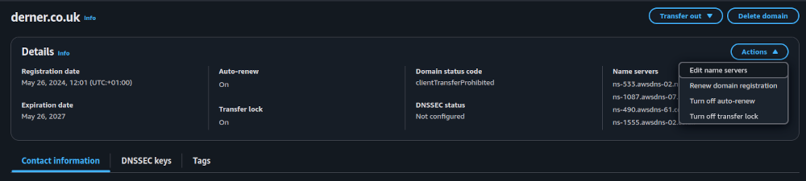
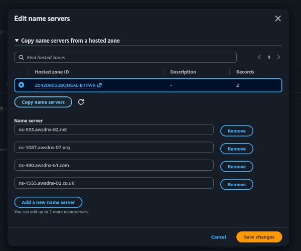

# Disaster recovery

This document covers standing up the website in a disaster recovery scenario (i.e. all resources are lost).


## 1 Recover domain

You may need to register the domain all over again.

In this case go to the Route53 service and register the domain. This will create a hosted zone for you automagically.


## 2 Sync the hosted zone

You will now either have registered your domain and been provided a hosted zone, or your domain was still stood up but your hosted zone was destroyed.


### hosted zone has been provided

In this case it's easiest to import your current hosted zone. To do this, run `cdk import hosted-zone-stack` and follow the instructions.


### hosted zone is down

In this case you need to stand up your hosted zone but the name servers in your NS record (name server record) on your hosted zone will differ from name servers named in your domain settings. This needs to be fixed and given enough time to propagate before a DNS validated certificate can be produced... or anyone can resolve the domain name for that matter.  
First things first, you need a hosted zone stood up. Run `cdk deploy hosted-zone-stack` to stand that up.  
Next you need to navigate to your registered domain in Route53, choose to edit the name servers and then copy the name servers from your hosted zone:  
  
  
Unfortunately, these changes can take a while to propagate (up to 24 hours).

Now you need to validate that DNS is working for your domain. One useful tools for this is `dig`. Substituting the domain, you can run the command `dig {domain}` e.g. `dig derner.co.uk`. Dig will give you the results of interrogating DNS. Another useful tool is `ping`. You can run the command `ping {domain}` e.g. `ping derner.co.uk`.

You can keep running these commands until you get consistent success. **Note** a single success is not what we're looking for, we're looking for repeatable success since you could have gotten lucky with which DNS you've hit.

Failed ping
```
ping: derner.co.uk: Temporary failure in name resolution
```

Failed dig
```
; <<>> DiG 9.20.24-1ubuntu0.4-Ubuntu <<>> derner.co.uk
;; global options: +cmd
;; Got answer:
;; ->>HEADER<<- opcode: QUERY, status: SERVFAIL, id: 24146
;; flags: qr rd ra; QUERY: 1, ANSWER: 0, AUTHORITY: 0, ADDITIONAL: 1

;; OPT PSEUDOSECTION:
; EDNS: version: 0, flags:; udp: 65494
;; QUESTION SECTION:
;derner.co.uk.                  IN      A

;; Query time: 181 msec
;; SERVER: 127.0.0.53#53(127.0.0.53) (UDP)
;; WHEN: Mon Nov 02 01:28:45 GMT 2026
;; MSG SIZE  rcvd: 41
```

Successful ping
```
ping: derner.co.uk: No address associated with hostname
```

Successful dig
```
; <<>> DiG 9.20.24-1ubuntu0.4-Ubuntu <<>> derner.co.uk
;; global options: +cmd
;; Got answer:
;; ->>HEADER<<- opcode: QUERY, status: NOERROR, id: 8911
;; flags: qr rd ra; QUERY: 1, ANSWER: 0, AUTHORITY: 1, ADDITIONAL: 1

;; OPT PSEUDOSECTION:
; EDNS: version: 0, flags:; udp: 65494
;; QUESTION SECTION:
;derner.co.uk.			IN	A

;; AUTHORITY SECTION:
derner.co.uk.		30	IN	SOA	ns-533.awsdns-02.net. awsdns-hostmaster.amazon.com. 1 7200 900 1209600 86400

;; Query time: 113 msec
;; SERVER: 127.0.0.53#53(127.0.0.53) (UDP)
;; WHEN: Mon Nov 02 08:56:14 GMT 2026
;; MSG SIZE  rcvd: 125
```


## 3 Request a public TLS certificate

In order for HTTPS to work, we need a TLS certificate. It's easiest to verify via DNS (where you edit your DNS records). However, DNS validation needs the previous step completed as the validation is looking up your domain and inspecting the records. You can to pull of cert validation if you get DNS resolution only some of the time but not every time, you just won't be able to guarantee net traffic until DNS resolves always. Once you've got DNS resolution you simply need to perform the command `cdk deploy cert-stack`. This command may take a while as it will hang while your cert validates, so make sure you have some fresh credentials if possible.


## 4 Deploy remaining infrastructure

This is not a "draw the rest of the owl" situation, this is a "cross your 't's and dot your 'i's" scenarios. We have the complicated mess of domains, traffic routing and certificates sorted. We just need somewhere to actually host the website (which is done with S3 + Cloudfront).  
So just run `just deploy-infra`, this just recipe deploys all stacks (of which only one remains to be deployed) but crucially it outputs the CDK Stack outputs to a file that can be then be read back. **N.B.** if the bucket already exists, just delete it. Now this deployment will take a significant amount of time as the Cloudfront CDN creation hangs while the edge locations populate. So again, make sure you've got some fresh credentials if possible.


## 5 Publish the website

Finally, it's time to publish the website.  
Simply run `just publish-site`. This will pick up the stack outputs, automatically detecting the bucket name and cloudfront distribution id.